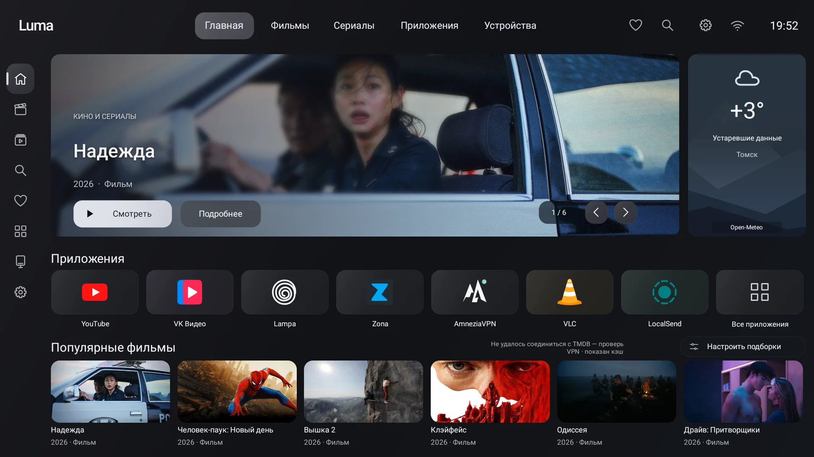
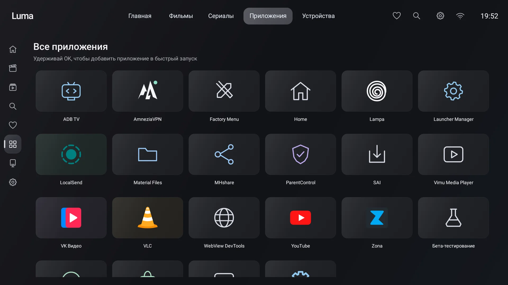
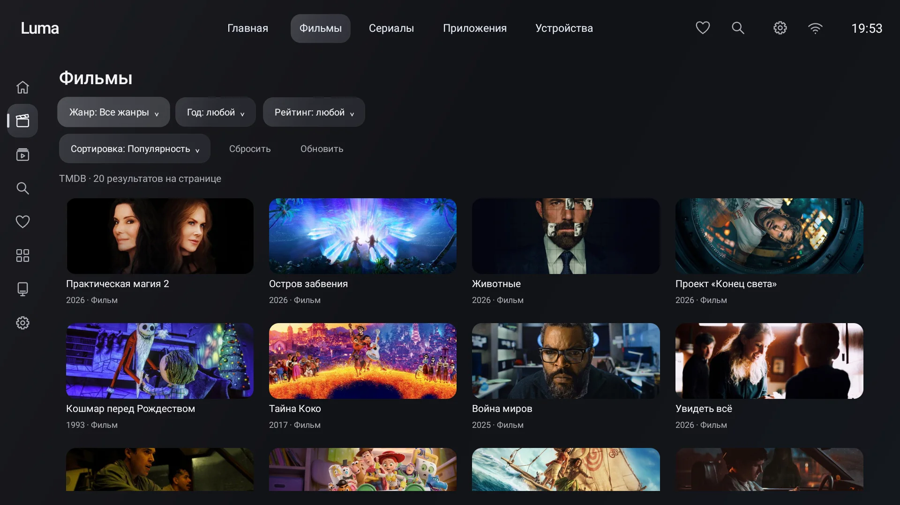
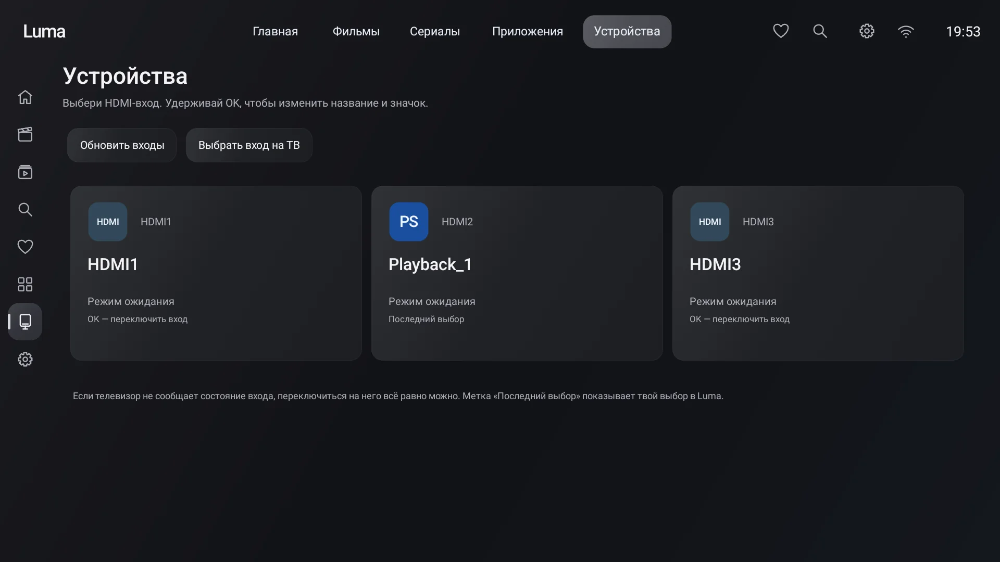
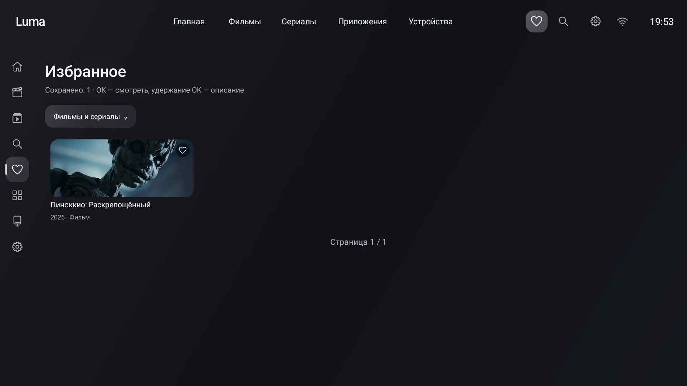

# Luma 1.0.0

Нативный лаунчер для Android TV с управлением пультом, каталогом TMDB и главным экраном в графитовом оформлении. Java, Android Views, без WebView и стороннего UI SDK.

## Скриншоты

Реальный интерфейс Luma на SaluteTV, Android 13.



| Приложения | Фильмы |
| --- | --- |
|  |  |

| HDMI-устройства | Избранное |
| --- | --- |
|  |  |

## Возможности

- Общая навигация и боковое меню с подписями, поиск и избранное.
- Фильмы и сериалы: жанр, год, минимальная оценка, сортировка, страницы каталога.
- Главная: баннер, быстрый запуск приложений, до трёх подборок, погода.
- Долгое OK на приложении: добавить в быстрый запуск; на главной — переставить стрелками.
- Долгое OK на фильме: описание, постер, оценка, длительность и избранное.
- Открытие выбранной карточки в установленной Lampa. Воспроизведение выполняет внешнее приложение.
- Управление туннелем AmneziaWG при выданном разрешении и разрешённом внешнем управлении.
- HDMI: входы, ручные названия и значки, запрос переключения. Доступные сведения зависят от прошивки.
- Резервные копии порядка приложений, избранного, фильтров и настроек без токена TMDB и ключей VPN.

Минимум Android 8 / API 26. Проверено пользователем на SaluteTV Android 13; универсальная совместимость с другими прошивками не подтверждена. Приложение не получает root и не отключает системные пакеты автоматически.

## Сборка

Нужны **JDK 17**, Android SDK Platform 35 и Build Tools 35.0.0. Gradle 8.9 / Android Gradle Plugin 8.7.3 закреплены в проекте. Java 25 для запуска этой версии Gradle не подходит.

В Android Studio открой корень проекта, выбери JDK 17 в Gradle JVM, дождись синхронизации и нажми Run.

```bash
bash ./gradlew --no-daemon :app:assembleDebug
```

APK: `app/build/outputs/apk/debug/app-debug.apk`. Для сборки нужен доступ к Google Maven, Maven Central и Gradle distributions. Не добавляй `local.properties` или ключ подписи в Git.

## Установка и обновление

```bash
adb connect TV_IP:5555
adb -s TV_IP:5555 install -r app/build/outputs/apk/debug/app-debug.apk
```

**Для обновления установленного Luma используй прежний локальный debug-ключ.** APK из CI подписан ключом конкретного runner и может не установиться поверх твоей версии. Не удаляй приложение ради обхода ошибки подписи. Подробнее: [подпись и миграция](docs/signing.md).

Для переноса этого обновления в существующий Java-проект можно выполнить `bash install.sh "/путь/к/проекту"`. Без аргумента сохранён совместимый путь прежнего проекта в Downloads. Скрипт создаёт копию исходников, обновляет файлы и убирает два устаревших растровых ресурса; команда точного отката выводится в конце.

После установки нажми Home и выбери Luma, если прошивка предлагает выбор. Автоматического отключения штатного лаунчера нет.

## Настройка

**TMDB:** Настройки → Каталог → Ввести токен. Используется твой API Read Access Token. Он хранится через Android Keystore; в исходники и копии настроек не включается. Импорт из буфера обмена macOS: `bash configure-token.sh TV_IP:5555`. Не вставляй токен в issue, лог или команду терминала.

**VPN:** установи AmneziaWG, один раз подключи туннель вручную, разреши внешнее управление и укажи его имя в настройках Luma. Если Android скрывает владельца VPN, статус не считается доказательством активности нужного туннеля. Раздельная маршрутизация приложений настраивается в VPN-клиенте, не в Luma.

**Погода:** Open-Meteo. В настройках выбери «Погода», введи название и выбери город с регионом и страной. По умолчанию — Томск; выбранный город сохраняется. Кнопка «Обновить погоду» повторяет запрос. GPS не используется. Поиск городов — Open-Meteo / GeoNames.

**Копии:** Настройки → Сохранить копию / Восстановить копию. Через ADB: `bash backup-settings.sh save /путь/копия.json TV_IP:5555` и аналогичный `load`. Сначала создай копию на ТВ; после load подтверди восстановление на ТВ. При единственном подключённом устройстве адрес можно опустить; также поддерживается `ANDROID_SERIAL`.

При отсутствии сети сохранённые подборки остаются доступны. Первичная загрузка без сети и без кэша невозможна. Доступность TMDB зависит от сети и региона.

## Проверки и CI

```bash
python3 tools/check-publication.py
python3 -m unittest discover -s tools/tests
bash ./gradlew --no-daemon :app:lintDebug jvmRegression
```

`jvmRegression` компилирует все Java-исходники и запускает **348 проверок** против Android 13 из Robolectric android-all; это не эмулятор и не тест отрисовки. Python проверяет сборщик диагностики и публикационный фильтр. Workflow [Build Luma](.github/workflows/build.yml) запускает эти проверки, lint и сборку debug APK. Сторонние Actions закреплены по SHA, доступ workflow — только чтение, подписывающих секретов нет.

Диагностика: `python3 tools/tv-check.py snapshot --serial TV_IP:5555`. Режим measure перезапускает только Luma и посылает стрелки/Back; check просит выполнить действия на ТВ вручную. Отчёты могут содержать названия установленных программ и HDMI-устройств; проверь их перед публикацией. Автоподключения к заранее заданному личному IP нет.

## Ограничения

Продолжение просмотра, раздельный VPN, загрузочная заставка и автообновление APK не реализованы. HDMI не гарантирует определение видеосигнала или активного входа. Сетевые сервисы и внешние приложения не входят в поставку. Тестирование на ТВ всё ещё необходимо после изменения UI.

## Исходники и лицензия

[MIT](LICENSE) для собственного кода Luma; [компоненты и оформление](THIRD_PARTY_NOTICES.md), [приватность](docs/privacy.md), [история версий](CHANGELOG.md), [подготовка к публикации](docs/publication.md).

Данные и изображения каталога: [TMDB](https://www.themoviedb.org). This product uses the TMDB API but is not endorsed or certified by TMDB.

## Версия 1.0.0

Собрана на основе 0.12.0, работу которой пользователь подтвердил на своём ТВ. В 1.0.0 изменены версия и документация; поведение приложения соответствует 0.12.0. Открытое дерево подготовлено с чистой историей; прежний приватный проект не переносится. Инструкция итоговой сборки: [docs/release-1.0.0.md](docs/release-1.0.0.md).
